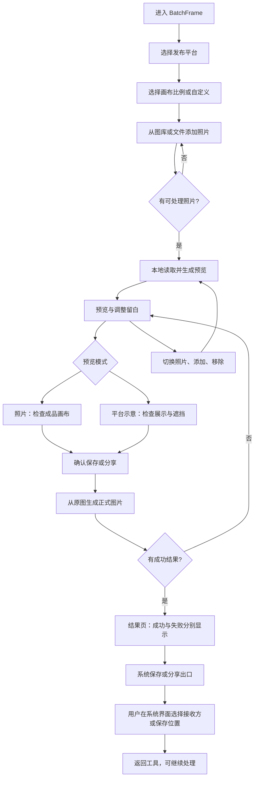
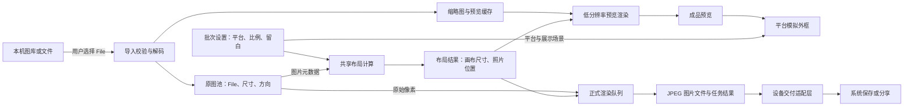

# BatchFrame 手机端流程与线框草案

日期：2026-10-09。状态：待评审，用于先定业务与数据边界；未修改应用代码。

## 唯一选定的 UI 方向

用户已选择 [手机端 UI 参考图](design/mobile-ui-selected.png)，并授权执行实现。后续均以此图为准，此前生成的其他方向不再作为候选。

保留浅色界面、局部平台模拟、照片缩略图、白边/相纸/摄影师参考分类、真实相纸规格选择、底部独立画布设置以及保存或分享操作。无顶部步骤条，无百分比滑杆。图片中的规格比例与平台外框仍需在实现阶段按文档校正，不能直接以生成图像的像素作为准确参数。

## 1. 已确定的产品边界

- 手机端优先，保留 BatchFrame 自身的操作界面。
- 主流程：选择平台 → 选择画布比例 → 导入、预览与保存。
- 顶部不显示步骤条、步骤圆点或连线。页面标题与返回按钮负责定位和导航。
- 留白不用百分比滑杆；使用「无、窄、标准、宽」可视化档位，另设自定义入口。数值细节不占据主页面。
- 预览区可切换「照片」「平台示意」。平台示意只提供大致布局、照片占位与控件遮挡，不复刻完整社媒应用。
- 照片完整适配画布；比例补白与用户额外留白共同构成成品。
- 手机端主流程交付图片文件，不交付 ZIP。应用不直接代用户发布到社媒。
- 图片处理在设备本地进行；模拟界面不读取社媒账号，也不向平台上传照片。

## 2. 业务流程



返回上一步保留导入照片。更改比例或留白会使已有成品失效，需要重新生成。用户取消系统交付时保留结果，可以再次操作。部分失败允许交付成功图片，并重试失败项。

## 3. 数据流与架构边界



**平台外框属于预览 UI，不进入输出图片。** 输出只包含照片、目标画布和留白。正式渲染必须重新读取原图，不能放大缩略图作为成品。预览与正式渲染使用同一套布局规则。

建议数据对象：

- `PhotoAsset`：id、原始 File、文件名、尺寸、方向、读取状态。
- `BatchSettings`：平台、目标比例、留白档位及其内部计算值、输出尺寸与品质。第一版全批次共用设置，不增加逐图例外。
- `PreviewState`：当前照片 id、照片/平台模式、平台展示场景、浅色/深色外框。外框主题不影响成品。
- `LayoutResult`：画布宽高、照片绘制区域、补白结果。
- `OutputItem`：照片 id、生成版本、结果文件、成功/失败状态及原因。
- `DeliveryState`：可用交付方式、已生成数量、交付尝试状态。系统面板关闭不等于已保存到相册。

缓存只服务当前会话；移除照片时释放其预览资源，替换预览时释放旧资源。批次设置变化递增版本，过期渲染结果不覆盖新版本。处理中锁定批次设置，取消后回到可编辑状态。

## 4. 手机页面线框

以下是信息结构，不是视觉稿。页面内容可滚动，底部主操作固定；不要求将全部控件挤进一屏。

### 页面 A：选择平台

```text
┌────────────────────────────┐
│         BatchFrame         │
│                            │
│ 选择发布平台               │
│ 小红书                     │
│ 微信朋友圈                 │
│ Instagram                  │
│ 抖音 / 其他已支持场景      │
│ 自定义                     │
│                            │
│             继续           │ ← 固定底部
└────────────────────────────┘
```

平台选择决定比例建议及可用模拟外框。不是登录或绑定平台账号。

### 页面 B：选择比例

```text
┌────────────────────────────┐
│ ‹       画布比例           │
│ 已选平台：小红书           │
│                            │
│ [3:4] [1:1] [其他比例]     │
│ [自定义宽 : 高]            │
│ 用小比例框表达形状与场景   │
│                            │
│             继续           │
└────────────────────────────┘
```

平台比例是建议；实际平台规格与适用场景需在实现前核实。自由比例始终可用。

### 页面 C：导入、预览与调整

```text
┌────────────────────────────┐
│ ‹       预览与保存         │
│ 小红书 · 3:4        修改   │
│                            │
│     [照片 | 平台示意]      │
│ ┌────────────────────────┐ │
│ │ 简化平台头部            │ │
│ │ ┌────────────────────┐ │ │
│ │ │ 白边               │ │ │
│ │ │ 完整照片           │ │ │ ← 主预览
│ │ │ 白边               │ │ │
│ │ └────────────────────┘ │ │
│ │ 简化文案与互动占位      │ │ │
│ └────────────────────────┘ │
│ 平台布局示意              │
│ [缩略图][缩略图][缩略图][+]│ ← 横向滚动
│ 当前 1/6          移除    │
│ 留白                      │
│ [无] [窄] [标准] [宽]     │ ← 小图展示边框厚度
│                 自定义 ›  │
│                            │
│       生成 6 张照片        │ ← 固定底部
└────────────────────────────┘
```

没有照片时，主预览区显示「添加照片」入口，生成按钮禁用。导入后使用真实照片。平台示意只在预览容器内出现，外层流程和工具控件保持一致。

平台外框建议支持：小红书帖子详情与双列信息流、Instagram 帖子、抖音图文。朋友圈及其他场景按后续支持范围增加。信息流里的邻近帖子仅为占位，不能被当作用户导入照片或输出内容。

留白选项使用同一照片、同一画布比例的小图展示厚度差异，点击立即更新主预览，选中态清晰。「无」表示不增加额外留白；完整适配目标比例所需的补白仍然保留。档位的实际厚度待视觉对比后确定，不直接沿用当前百分比。

自定义入口打开底部面板，建议使用「更窄 / 更宽」按钮逐级调整，并同步显示预览；不使用连续百分比滑杆。确认后主页面显示「自定义」选中状态。此交互为建议方案，后续线框需检验点击成本与调整精度。

### 页面 D：处理与交付

```text
┌────────────────────────────┐
│          图片已生成        │
│ 成功 5 张 · 失败 1 张      │
│ [结果缩略图列表]           │
│ 失败照片与原因 / 重试      │
│                            │
│ [保存或分享 5 张照片]      │ ← 按设备能力显示出口
│ [逐张保存]                │ ← 需要时提供降级路径
│ [返回调整]                │
└────────────────────────────┘
```

## 5. 手机交付需要先验证的边界

「保存到相册」是用户目标，不能直接等同于浏览器下载，也不能在未验证时承诺一键写入相册。交付适配层需要通过目标设备实测确定：

- 可直接保存时，显示「保存到相册」。
- 可调用系统文件分享时，显示「保存或分享」，用户在系统面板完成下一步。
- 批量交付不可用时提供逐张交付，并显示当前张数。
- 系统无法确认最终保存结果时，只记录「已打开分享面板」等可观测状态，不显示「已保存到相册」。

原生 App 的相册权限与保存接口属于将来的交付适配器，不作为当前 Web 已有能力。

## 6. 本轮建议先定的决策

1. 保持三个业务阶段，导入在预览页完成；移除顶部步骤条，通过标题与返回按钮导航。
2. 第一版全批次共用比例和留白，平台外框仅用于预览。
3. 先采用「生成图片 → 结果页保存或分享」两段流程，避免将生成成功与保存成功混为一谈。
4. 优先验证 iPhone Safari 与 Android Chrome 的图片交付，再确定正式按钮文案。
5. 此文档通过后，再画手机端线框细节与视觉稿，最后实施代码。
6. 留白采用可视化档位与自定义入口，去掉百分比滑杆。

当前入口已改为本地图片生成与系统分享/逐张保存。界面与设备交付仍需浏览器验收；上文中的实机验证项目不代表已通过。

## 7. 相纸规格与摄影师边框预设

可选择不同真实相纸；普通边框预设从著名摄影师的具体作品、画册或展览印相中提取总结。首版已实现三种 instax 规格，并收录 Walker Evans 单件印相尺寸参考；继续扩展前按下述方法研究。

布局层级：原图 → 相纸成像区或摄影师边框 → 外层发布画布 → 平台示意外框。平台示意永不进入成品。相纸与摄影师边框是两种独立风格，第一版不叠加，避免比例规则冲突。

### 相纸选择

使用可视化横向模板列表，展示真实外形和成像区，而不是只显示文字或改变底边厚度。所有尺寸均以宽 × 高表示：

- instax mini：相纸 54 × 86 mm；成像区 46 × 62 mm。
- instax SQUARE：相纸 72 × 86 mm；成像区 62 × 62 mm。
- instax WIDE：相纸 108 × 86 mm；成像区 99 × 62 mm。
- Polaroid 600 / i-Type：列为候选，正式纳入前核实具体产品及成像区规格；不将所有宝丽来格式视为同一个模板。

来源：[富士官方胶片规格](https://www.fujifilm.com/us/en/consumer/instax/film)、[SQUARE 官方手册](https://asset.fujifilm.com/www/ar/files/2025-07/551020c1b944bad817a405792ecc959d/instax_squaresq1_manual.pdf)、[WIDE 官方资料](https://asset.fujifilm.com/www/ca/files/2020-12/1008a588df16e2c2e91ad1393c498bb2/instax_300_catalogue.pdf)。

相纸外形和成像区比例锁定，外层画布可独立选择。具体成像区偏移需实物或官方图核实，不能只凭总尺寸推断上下边距。默认保持原图完整适配成像区；如以后提供满幅裁切，应独立选择并明确预览，不静默裁切。毫米用于定义比例，屏幕显示不是实物等大，也不保证下载图片打印后的物理尺寸。

### 摄影师边框提取方法

不能凭摄影师名气分配一个任意百分比。每个预设应对应可追溯的作品系列或出版版本，避免宣称某位摄影师始终使用固定边框。

1. 从摄影师官网、授权画廊、博物馆或正式画册资料收集能看到完整纸张边缘的参考。
2. 将照片原始画幅、印相纸张边框、画册页边距、装裱卡纸分别标识，不混为同一参数。
3. 测量照片区域与纸张边界，提取上/右/下/左边距、图像位置及外框比例；对透视、裁切和低清图片标记不确定性。
4. 同一系列尽量核对多张，记录比例范围；样本不足时标记「单件作品参考」，不称为摄影师标准。
5. 在统一示例照片上对比效果，选定可用参数后形成预设，并保留来源与测量记录。

预设信息应含：id、显示名称、摄影师、作品/系列、出版版本、来源链接、样本数量、画幅适用范围、边距四元组、归一化基准、对齐方式、测量置信度、是否允许调整。比例内部用于计算，用户通过小图选择。

边距建议统一相对于外框短边归一化；将原图完整适配到边距限定的区域，产生的额外补白另记。无法同时保留原图比例和参考边距时，预览真实适配结果，不伪称精确复现参考。

命名采用「某系列印相参考」或「某画册版式参考」，并在详情显示来源。当前只有 Walker Evans 的馆藏单件尺寸参考：纸张 99 × 130 mm、图像 94 × 121 mm，居中边距为推算；不是四边实测或摄影师统一标准。来源：[Smart Museum 馆藏 1980.79](https://smartcollection.uchicago.edu/objects/4644/untitled-portrait-of-man-with-display-case)。其他摄影师未经研究不得添加名字或比例。

### 线框调整

底部设置依次为「风格：简洁白边 / 相纸 / 摄影师参考」→ 对应模板横向列表 → 外层画布。选择相纸显示真实规格；选择摄影师参考显示来源入口。继续不显示顶部步骤条，不使用百分比滑杆。
